  

  

### Personal projects

<table>
  <tr>
    <td width="50%" valign="top">
      <a href="https://github.com/Andrew2142/PRVision"><b>PRVision</b></a> 
      Before/after renders of every UI component a pull request touches, with pixel diffs and a plain-language summary.
    </td>
    <td width="50%" valign="top">
      <a href="https://github.com/Andrew2142/IW4DOOM"><b>IW4DOOM</b></a> 
      Modern Warfare 2 gunplay and 3D viewmodels in the classic Doom engine, written in Rust.
    </td>
  </tr>
  <tr>
    <td width="50%" valign="top">
      <a href="https://github.com/Andrew2142/php73-backport"><b>php73-backport</b></a> 
      PHP 7.3 with the latest security fixes, rebuilt for Ubuntu 18.04, 20.04 and Debian 10.
    </td>
    <td width="50%" valign="top">
      <a href="https://github.com/Andrew2142/Skyforge"><b>Skyforge</b></a> 
      A Claude Code skill that runs your prompts like a factory floor: one manager, many background workers.
    </td>
  </tr>
  <tr>
    <td width="50%" valign="top">
      <a href="https://github.com/Andrew2142/devgaurd"><b>devgaurd</b></a> 
      A local MCP server for Codex and Claude Code that tests, lints and scans your changes without touching the repo.
    </td>
    <td width="50%" valign="top">
      <a href="https://github.com/Andrew2142/plannie"><b>plannie</b></a> 
      An agent skill that keeps you involved in planning, so plans come out detailed enough to run in one shot.
    </td>
  </tr>
</table>

### Stack

TypeScript · Node.js · PHP · Angular · React · iOS · Android
